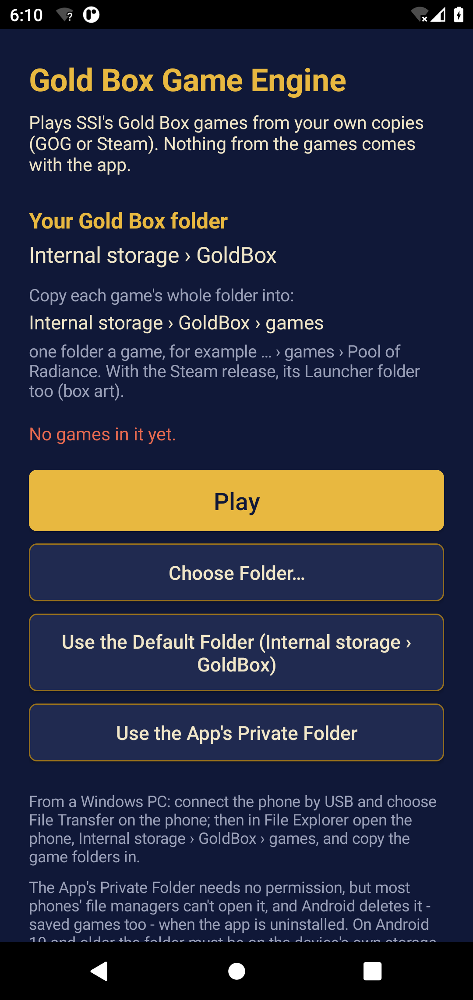
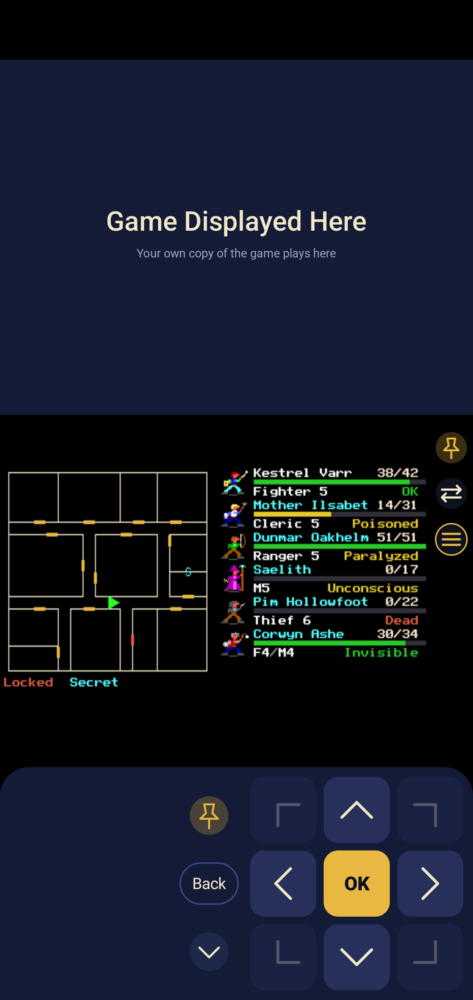
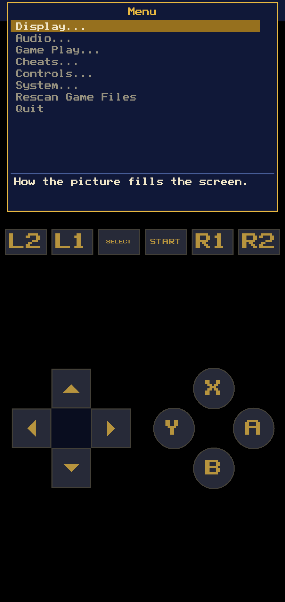
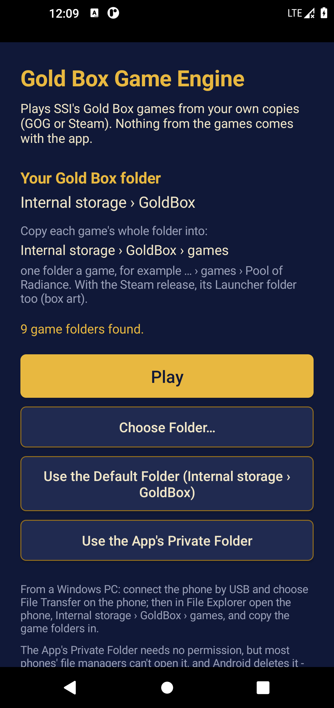
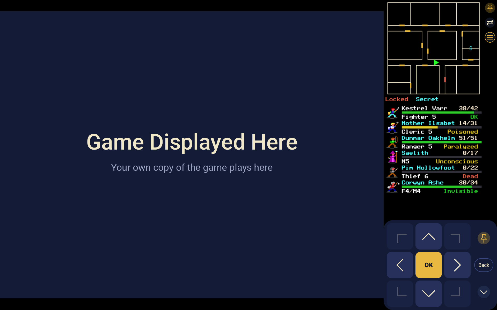
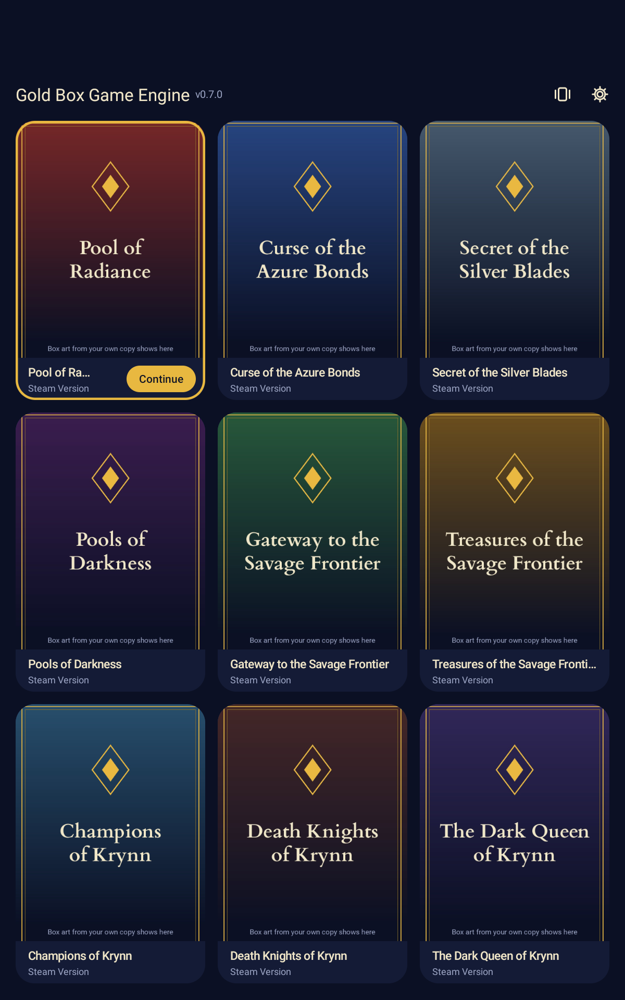
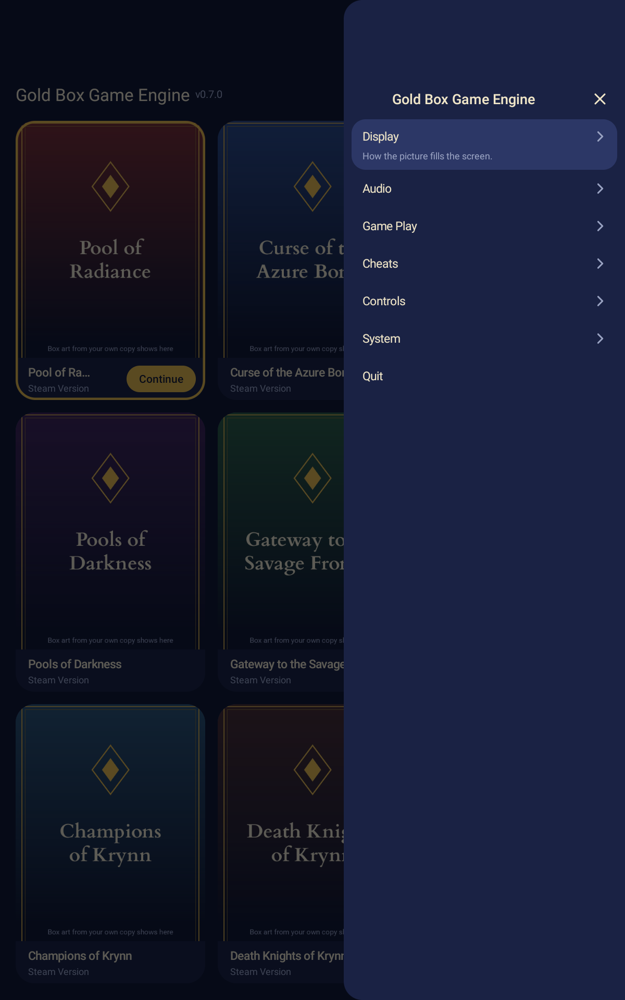
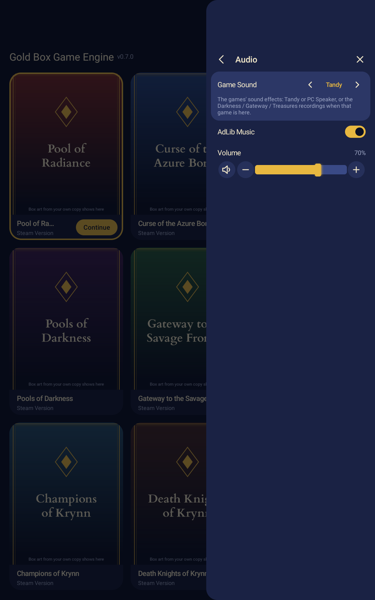

# Gold Box Game Engine for Android

Play SSI's Gold Box AD&D games on an Android phone, tablet or Android handheld, using **your own copies** (GOG or Steam).

- Pool of Radiance
- Curse of the Azure Bonds
- Secret of the Silver Blades
- Pools of Darkness
- Gateway to the Savage Frontier
- Treasures of the Savage Frontier
- Champions of Krynn
- Death Knights of Krynn
- The Dark Queen of Krynn

It is the [CYD Gold Box Game Engine](https://github.com/tomtombombadil/CYD-GoldBoxGameEngine)
with the front end of its [PortMaster port](https://github.com/tomtombombadil/PM-GoldBoxGameEngine):
tweaked for Android and a clean touch interface. It's got the same engine, the same menus, the journals, the Companion, Quick Actions,
Game Fixes, Cheats, and all the rest.

**Bring your own game.** Nothing from the games comes with the app; it reads
the game files you copy onto the device.

Not on the Google Play Store! Get it from the
[Releases](https://github.com/tomtombombadil/APK-GoldBoxGameEngine/releases)
page (`GoldBoxGameEngine-<version>.apk`) - or from F-Droid once it is there. (soon!)

## Screenshots

The game's own picture is shown as "Game Displayed Here", and the Companion's map, party and icons are made up for these screenshots: nothing from the games is shown or included. This is so that the original rights and ownership of the games is respected. Sorry, but you'll have to envision Pool of Radiance or your favorite Gold Box game in the 'Game Displayed Here' area. Also, the game art from the original games is not shown here, but will appear once you've added your game files from the original games. The box art and logos make the app look really great.

### Phone

<p>
  
</p>
<p>
  
  &nbsp;&nbsp;&nbsp;
  
  &nbsp;&nbsp;&nbsp;
  
</p>

### Tablet

<p>
  
</p>
<p>
  
  &nbsp;&nbsp;&nbsp;
  
  &nbsp;&nbsp;&nbsp;
  
</p>

## Installing

1. On the phone, open the newest release's `GoldBoxGameEngine-<version>.apk`
   (or download it on a PC and copy it over).
2. Android asks whether your browser or file manager may install apps:
   allow it for this once.
3. Open **Gold Box Game Engine**.

## Where the games go

The first start shows the **folder screen**:

- **Play** uses the default folder: **Internal storage › GoldBox**. The app
  asks for **All Files Access** - it reads and writes only in that folder.
- **Choose Folder…** points the app at a folder of your own: anywhere on
  the device's storage, or an SD card (Android 11 and later).
- **Use the App's Private Folder** needs no permission, but most file
  managers can't open it, and Android deletes it - saved games too - when
  the app is uninstalled.

Copy each game's **whole folder** into the folder's **`games`** folder, one
folder a game:

```
Internal storage
└── GoldBox
    ├── games
    │   ├── Pool of Radiance
    │   ├── Curse of the Azure Bonds
    │   └── Launcher            (the Steam release's - its box art)
    ├── conf                    (settings - the app makes it)
    └── log.txt
```

**From a Windows PC:** connect the phone with a USB cable, and on the phone
choose **File Transfer** (the USB notification). In File Explorer the phone
shows under This PC: open it, then **Internal storage › GoldBox › games**,
and copy the game folders in. Then open the app - the first start with new
games makes each game's picture, journal and music once ("the scan").

Another folder later: in the app, **Start › System › Games Folder**.

If you choose a folder that holds the game folders themselves (no `games`
folder inside), the app uses it as the games folder.

## Controls

Any mix of:

- **A controller** - Bluetooth or USB, or an Android handheld's own buttons:
  the handheld port's controls ([its button guide](https://github.com/tomtombombadil/PM-GoldBoxGameEngine#controls)).
- **The on-screen buttons** - D-Pad, A, B, X, Y, L1, R1, L2, R2, Start,
  Select: beside the game held sideways, under it held upright. They hide
  while a controller is used and come back at a touch.
  **Start › Controls › On-Screen Buttons**: Auto, Always or Never.
- **Touch**: in the game a tap is the game's own (a menu word, a character).
  In the menus: tap a line to pick it, tap it again to choose it; swipe to
  scroll; swipe across to change a setting. The game list: tap its sides for
  the next game, its middle to play, its title bar for the menu. **Two
  fingers together = Start** (the menu); the phone's **Back = B**.

## Building

GitHub Actions builds the APK on every push (the run's Artifacts) and
publishes a release for a `v<version>` tag (`.github/workflows/build.yml`).

By hand (Windows): Android Studio's SDK Manager with **NDK 27.3.13750724**
and **CMake 3.22.1**, then in PowerShell:

```powershell
git clone --recurse-submodules https://github.com/tomtombombadil/APK-GoldBoxGameEngine
cd APK-GoldBoxGameEngine
.\gradlew.bat assembleDebug
```

The APK: `app\build\outputs\apk\debug\GoldBoxGameEngine-<version>-debug.apk`.

The repo: `app/` the Android app (the folder screen, `SetupActivity`; the
game, `GoldBoxActivity` on SDL's activity; `app/jni/CMakeLists.txt` builds
the engine and front end), `pm/` the PortMaster port (submodule - the front
end `pm/src`, the engine `pm/cyd`), `SDL/` SDL 2 (submodule, release-2.32.10),
`fastlane/` the store text F-Droid shows, `docs/FDROID.md` the F-Droid
submission.

## License

MIT (`LICENSE`). Third-party parts: `THIRD_PARTY_NOTICES.md`.
